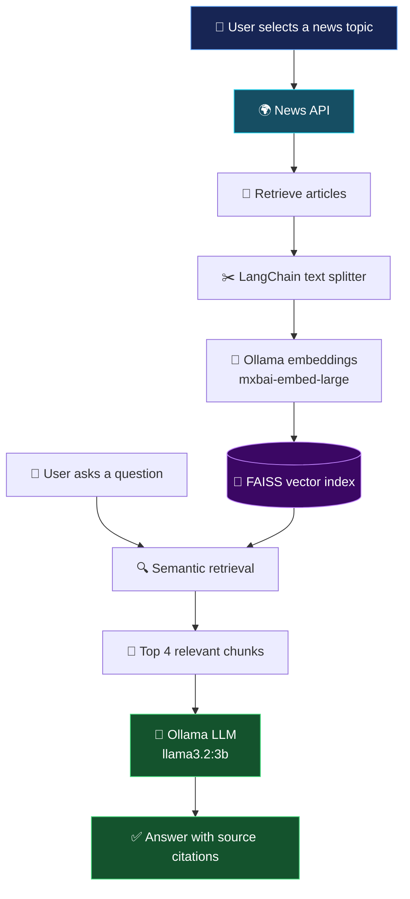

# 📰 Real-Time RAG News Chatbot

### Ask questions. Explore the latest news. Get context-aware answers with sources.

An AI-powered **Retrieval-Augmented Generation (RAG)** chatbot that fetches news articles in real time and lets users ask natural-language questions about them.

Instead of manually browsing multiple articles, the system retrieves relevant information, searches its local vector index, and generates answers grounded in the retrieved news—with source citations to help users verify the information.

<p align="center">
  
  
  
  
  
</p>

---

## ✨ What can it do?

| Feature | Description |
|---|---|
| 🌍 Real-time news | Fetch articles on user-selected topics through News API |
| 🧩 Smart chunking | Split article content into smaller, searchable text segments |
| 🧠 Semantic search | Find relevant information using local vector embeddings |
| ⚡ Fast retrieval | Search an in-memory FAISS index for the top 4 relevant chunks |
| 🤖 Local AI inference | Generate responses with Ollama's `llama3.2:3b` model |
| 🔗 Source citations | Display relevant article sources alongside answers |
| 🎨 Interactive dashboard | Dark glassmorphism UI with chat, article cards, and status indicators |
| 🔒 Local model execution | Run embedding and chat models locally through Ollama |

## 🖥️ User interface

The dashboard is designed around three main tasks:

- **Configure & Ingest:** Choose a topic and the number of articles to retrieve.
- **Indexed Articles:** Browse the fetched news, including source, publication date, description, and links.
- **News Chat:** Ask questions and receive context-aware answers with source references.

> **Screenshot preview:** Add screenshots of your running dashboard here to make the repository more visual.

<!-- Replace these filenames with screenshots committed to your repository. -->
<!--
<p align="center">
  
</p>
<p align="center">
  
</p>
-->

---

## 🏗️ System architecture

The application follows a RAG pipeline: retrieve news, prepare the text, embed it, index it, retrieve relevant context, and generate an answer.



### 🔄 How the RAG pipeline works

<details>
<summary><strong>1. Fetch news articles</strong></summary>

The backend queries the News API using the selected topic and retrieves the available articles.

</details>

<details>
<summary><strong>2. Split article content into chunks</strong></summary>

LangChain's text splitter breaks article text into smaller segments to make retrieval more focused.

- Chunk size: `800` characters
- Chunk overlap: `150` characters

</details>

<details>
<summary><strong>3. Generate embeddings</strong></summary>

Ollama runs `mxbai-embed-large` locally to convert text chunks into numerical vector representations. The project is configured for 1024-dimensional embeddings.

</details>

<details>
<summary><strong>4. Index and retrieve relevant context</strong></summary>

FAISS stores the vectors in an in-memory index. When a question arrives, the application retrieves the top 4 relevant chunks using semantic similarity.

</details>

<details>
<summary><strong>5. Generate an answer with citations</strong></summary>

The retrieved context is passed to `llama3.2:3b` through Ollama. The model generates a response grounded in the available context, and the UI presents relevant source references.

</details>

---

## 🧰 Tech stack

| Layer | Technology | Purpose |
|---|---|---|
| Backend | Python, FastAPI | API endpoints and application logic |
| News retrieval | News API | Fetch current articles |
| RAG orchestration | LangChain | Text splitting and retrieval components |
| Embeddings | Ollama, `mxbai-embed-large` | Semantic text representations |
| Vector search | FAISS | Similarity search over indexed chunks |
| Language model | Ollama, `llama3.2:3b` | Context-aware answer generation |
| Frontend | HTML, CSS, JavaScript | Interactive web dashboard |
| Configuration | Environment variables | API keys and model settings |

---

## 🗂️ Project structure

```text
real-time-rag-news-chatbot/
│
├── app/
│   ├── __init__.py
│   ├── main.py              # FastAPI application and routes
│   ├── rag.py               # News retrieval and RAG pipeline
│   └── static/
│       ├── index.html       # Dashboard structure
│       ├── style.css        # Dark glassmorphism theme
│       └── app.js           # Chat and status-checking logic
│
├── .env                     # Local secrets (do not commit)
├── .gitignore               # Files excluded from Git
├── requirements.txt         # Python dependencies
├── notes.txt                # Developer notes
└── README.md                # Project documentation
```

*The tree above reflects the project structure described here. Update it if your actual repository contains additional files.*

---

## 🚀 Getting started

### Prerequisites

Install the following before running the application:

- Python 3.10 or newer
- [Ollama](https://ollama.com/download)
- A [News API](https://newsapi.org/) API key

### 1. Download the AI models

Start Ollama, then open a terminal and run:

```bash
ollama pull mxbai-embed-large
ollama pull llama3.2:3b
```

Verify that both models are available:

```bash
ollama list
```

### 2. Clone the repository

```bash
git clone <YOUR_REPOSITORY_URL>
cd <YOUR_PROJECT_DIRECTORY>
```

Replace the placeholders with your actual repository URL and directory name.

### 3. Create a virtual environment

**Windows — PowerShell**

```powershell
python -m venv venv
.\venv\Scripts\Activate.ps1
```

**macOS / Linux**

```bash
python3 -m venv venv
source venv/bin/activate
```

### 4. Install dependencies

```bash
python -m pip install --upgrade pip
pip install -r requirements.txt
```

### 5. Configure environment variables

Create a `.env` file in the project root:

```env
NEWS_API_KEY=your_news_api_key
EMBEDDING_MODEL=mxbai-embed-large
CHAT_MODEL=llama3.2:3b
OLLAMA_HOST=http://localhost:11434
```

Replace `your_news_api_key` with your actual News API key.

**Security note:** Never commit your `.env` file or expose your API key in screenshots, logs, or public repositories. If a credential is exposed, rotate it.

Ensure your `.gitignore` includes:

```gitignore
.env
venv/
__pycache__/
*.py[cod]
```

### 6. Start the application

Make sure Ollama is running, then start the FastAPI server from the project root:

```bash
uvicorn app.main:app --reload --host 127.0.0.1 --port 8000
```

Alternatively, if your application entry point supports direct execution:

```bash
python app/main.py
```

### 7. Open the dashboard

Visit:

**http://127.0.0.1:8000/**

If the page does not load, check the terminal logs and confirm that the server started successfully.

---

## 💬 Using the chatbot

1. **Choose a topic** — for example, `artificial intelligence`, `stock market`, or `NASA space missions`.
2. **Select article count** — configure how many articles to fetch.
3. **Fetch & Index News** — allow the application to retrieve articles and build its vector index.
4. **Explore the articles** — review available article details and source links.
5. **Ask a question** — for example, *“What are the latest developments in AI?”*
6. **Review the answer** — inspect the response and its cited sources to verify the underlying information.

---

## ⚙️ Configuration at a glance

| Setting | Purpose |
|---|---|
| `NEWS_API_KEY` | Authenticates requests to News API |
| `EMBEDDING_MODEL` | Selects the embedding model |
| `CHAT_MODEL` | Selects the answer-generation model |
| `OLLAMA_HOST` | Sets the Ollama service endpoint |
| Chunk size `800` | Controls the approximate length of each text chunk |
| Chunk overlap `150` | Preserves context between adjacent chunks |
| Top-k `4` | Controls the number of chunks retrieved per question |

*The chunking and top-k values describe the current configuration in this README. Confirm the actual implementation in `app/rag.py` before changing them.*

---

## 🧪 Troubleshooting

| Problem | What to check |
|---|---|
| News retrieval fails | Verify your API key, network connection, and News API usage limits |
| Ollama connection error | Ensure Ollama is running and `OLLAMA_HOST` is correct |
| Model not found | Run the relevant `ollama pull` command |
| Missing Python package | Activate the virtual environment and reinstall `requirements.txt` |
| Weak or irrelevant answers | Check article content, chunking, retrieval results, and the prompt context |
| No source citations | Confirm that source metadata is preserved through retrieval and returned by the backend |
| Dashboard does not load | Check the FastAPI logs and confirm the static frontend route is configured |

---

## 🧠 Why RAG?

A general-purpose LLM may not know the latest news, and it can produce answers unsupported by the articles a user is reading.

This project combines **retrieval** with **generation**:

- **Retrieval** finds relevant passages from fetched news.
- **Augmentation** supplies those passages as context for the model.
- **Generation** produces a natural-language response informed by that context.

The goal is to make news exploration more convenient and source-aware. Citations and retrieved context can help reduce unsupported answers, but they do not guarantee that every response is accurate or hallucination-free.

## 🔮 Potential improvements

- [ ] Add screenshots and a short demo GIF.
- [ ] Add automated tests for retrieval and answer generation.
- [ ] Display the retrieved passages used for each answer.
- [ ] Add persistent vector storage for reuse across sessions.
- [ ] Add article deduplication and improved source ranking.
- [ ] Track retrieval relevance, response latency, and answer groundedness.
- [ ] Improve handling of API errors, rate limits, and unavailable article content.

## 📌 Important limitations

- News retrieval depends on the availability, coverage, and usage limits of News API.
- The FAISS index is described as in-memory, so indexed data may not persist across restarts.
- Answer quality depends on the article content retrieved and the capabilities of the selected local model.
- Source citations help with verification but do not independently prove that a generated claim is correct.

## 👩‍💻 Contributing

Contributions and suggestions are welcome. For a change:

1. Fork the repository.
2. Create a feature branch.
3. Implement and test your change.
4. Open a pull request describing the improvement.

## 📄 License

Add a license section that reflects the license you choose for this project. Until a license is included, don't assume others have permission to reuse or redistribute the code.

---

<p align="center">
  <strong>📰 Less searching. More understanding.</strong><br/>
  <sub>Real-time news retrieval powered by RAG and local AI models.</sub>
</p>
